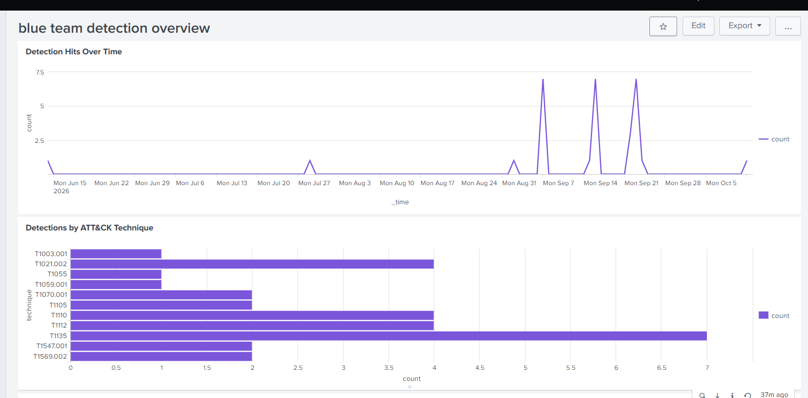

# Detection Engineering & MITRE ATT&CK Coverage Map

A home-lab project where I built, tested and tuned **11 Splunk detections** mapped to the MITRE ATT&CK framework. Each detection was validated against a real simulated attack, then checked for false positives.

**Stack:** Splunk Enterprise (Free license), Splunk Universal Forwarder, Sysmon (SwiftOnSecurity config, modified), Windows Event Logs, Atomic Red Team, MITRE ATT&CK Navigator.



## What this project shows

- A working log pipeline: a Windows 11 VM sends Sysmon and Windows Security/System logs to Splunk.
- 11 detections across 7 ATT&CK tactics, each tested with a real simulated attack.
- Real false-positive tuning, with before and after results.
- A Splunk dashboard and an ATT&CK coverage heatmap.

## Contents

- [Lab architecture](#lab-architecture)
- [Tools used](#tools-used)
- [Detection coverage](#detection-coverage)
- [ATT&CK coverage heatmap](#attck-coverage-heatmap)
- [Tuning results](#tuning-results)
- [Dashboard](#dashboard)
- [Troubleshooting stories](#troubleshooting-stories)
- [Limitations](#limitations)
- [How to reproduce](#how-to-reproduce)
- [Repository structure](#repository-structure)

## Lab architecture

```
 Physical laptop (host)                        VMware Workstation
┌──────────────────────────┐   Host-only     ┌──────────────────────────────┐
│ Splunk Enterprise        │   network       │ Windows 11 VM                │
│ (Free license)           │◄────────────────│  • Sysmon                    │
│ receives on TCP 9997     │  192.168.254.0  │  • Windows Event Logs        │
│ 192.168.254.1            │      /24        │  • Splunk Universal Forwarder│
└──────────────────────────┘                 │  • Atomic Red Team           │
                                             │ 192.168.254.130              │
                                             └──────────────┬───────────────┘
                                                            │ NAT adapter
                                                            ▼
                                                  Internet (package and
                                                  test downloads only)
```

**How it works**
1. Atomic Red Team runs a simulated attack on the Windows 11 VM.
2. Sysmon and the Windows Security and System logs record what happened.
3. The Splunk Universal Forwarder (running as Local System) sends those logs to Splunk over the Host-only network on TCP port 9997.
4. My detection searches in Splunk find the attack, and the dashboard summarises the hits.

**Network design**
- The VM has two adapters. The **Host-only** adapter carries log traffic to Splunk, so the lab stays isolated from my real network. The **NAT** adapter is only for internet access.
- A Windows Firewall inbound rule on the laptop allows TCP 9997, limited to the 192.168.254.0/24 subnet.

## Tools used

| Tool | Purpose |
|---|---|
| VMware Workstation | Runs the Windows 11 lab VM |
| Splunk Enterprise (Free license) | Log search, saved detections, dashboard |
| Splunk Universal Forwarder | Ships logs from the VM to Splunk |
| Sysmon | Detailed process, registry and process-access logging |
| Windows Event Logs | Security (logons, share access, log clearing) and System (service installs) events |
| Atomic Red Team | Simulates attacker techniques mapped to ATT&CK |
| MITRE ATT&CK Navigator | Coverage heatmap (ATT&CK v19) |

**Sysmon configuration:** I used the [SwiftOnSecurity sysmon-config](https://github.com/SwiftOnSecurity/sysmon-config) as the baseline, with one change. The default has no rules for ProcessAccess (EventCode 10), so nothing was logged for LSASS access. I added a rule that logs access to `lsass.exe`.

## Detection coverage

| Technique | Name | Tactic | Data source | How I tested it |
|---|---|---|---|---|
| T1059.001 | PowerShell (encoded command) | Execution | Sysmon EventCode 1 | Atomic test #17 |
| T1021.002 | SMB/Admin Shares | Lateral Movement | Security EventCode 5140 | Atomic test #1 (Map Admin Share) |
| T1003.001 | LSASS memory dump | Credential Access | Sysmon EventCode 10 | Atomic test #2 (comsvcs.dll) |
| T1070.001 | Clear Windows Event Logs | Defense Evasion | Security 1102 + Sysmon 1 | Manual `wevtutil cl Security` |
| T1547.001 | Registry Run Keys | Persistence | Sysmon EventCode 13 | Manual `reg add ...\Run` |
| T1112 | Registry Modification | Defense Evasion | Sysmon EventCode 13 | Manual `DisableRegistryTools` |
| T1135 | Network Share Discovery | Discovery | Sysmon EventCode 1 | Manual `net view` / `net share` |
| T1569.002 | Service Execution (PsExec-style) | Execution | System EventCode 7045 | Manual service pointing at `cmd.exe` |
| T1110 | Brute Force | Credential Access | Security EventCode 4625 | Manual repeated failed logons |
| T1105 | Ingress Tool Transfer | Command and Control | Sysmon EventCode 1 | Atomic test T1105-29 |
| T1055 | Process Injection | Defense Evasion | Sysmon EventCode 1 | Atomic test #13 (UUID custom process injection) |

Every query, validation note, tuning story and screenshot is in [docs/detections.md](docs/detections.md). The technique-to-data-source mapping is in [docs/attack-mapping.md](docs/attack-mapping.md).

## ATT&CK coverage heatmap


Green techniques have a detection built and validated. The Navigator layer file is [docs/detection-coverage-heatmap.json](docs/detection-coverage-heatmap.json).

Note: in ATT&CK v19, T1070.001 (Clear Windows Event Logs) appears as T1685.005 under Defense Impairment. This project uses T1070.001 in the docs and T1685.005 in the heatmap. Both are the same detection.

## Tuning results

A 30-minute baseline of normal activity showed no false positives, but reviewing **all-time** results exposed real ones.

| Technique | Before tuning | Fix | After |
|---|---|---|---|
| T1070.001 | About 27 false positives (Windows Defender `wevtutil install-manifest ... MpClient.dll`; the letters "cl" matched inside "MpClient") | Match ` cl ` or `clear-log` as whole words | 0 |
| T1547.001 | About 30 false positives (Microsoft Edge's own `MicrosoftEdgeAutoLaunch` Run-key value) | Regex for the real Run key path, and exclude Edge's own write | 0 |
| T1569.002 | 1 (simulated software installer service) | Only match services using `cmd.exe`, `powershell.exe` or `rundll32.exe` | 0 |
| T1110 | Flagged accounts after counting failures over all time, and double counted the computer account | Ignore computer accounts, count in 5-minute windows, require 5 or more failures | Only real test bursts |
| T1105 | 0 | Excluded Splunk's own `splunk-powershell.exe` helper | 0 |

**Lesson:** a detection that has only been checked against a short baseline is not finished. Test against a long history of normal activity.

## Dashboard

The "Blue Team Detection Overview" dashboard has three panels: detection hits over time, hits by ATT&CK technique, and the 10 most recent hits. Because Splunk Free has no triggered alerts, the dashboard is built from one combined saved search that covers all 11 detections.

## Troubleshooting stories

| Problem | Cause | Fix |
|---|---|---|
| Forwarder showed "unreachable network" | `outputs.conf` pointed at the wrong IP | Added a Host-only adapter, repointed `outputs.conf`, and opened TCP 9997 in the firewall |
| Firewall rule did not work on the Host-only network | The Host-only adapter has no network category | Enabled the rule on the Domain, Private and Public profiles, scoped to the lab subnet |
| Sysmon logs missing in Splunk (errorCode=5) | The forwarder service did not have permission | Changed the service's Log On account to Local System |
| LSASS detection logged nothing | The default Sysmon config has no ProcessAccess rule | Added a rule for `lsass.exe` and reloaded the config |
| Atomic tests quarantined by Windows Defender | Mimikatz-based tests are flagged | Used alternative tests that do not use external hacking tools |
| `reg.exe` and regedit blocked after the T1112 test | `DisableRegistryTools` blocks both | Reverted it with PowerShell `Remove-ItemProperty` |
| Splunk trial license expired | 60-day trial ended | Switched to Splunk Free |
| Wildcard search with a backslash matched too much | Splunk ignores backslashes in wildcard strings | Used `\| regex` with `[[:punct:]]` |
| Dashboard panels showed no results | The report's saved time range and a trailing period in the report name | Set the report to All time and used the exact report name |

## Limitations

- **No live alerts.** Splunk Free does not support alerts or scheduled searches. The intended alert settings are documented in [docs/alert-configuration.md](docs/alert-configuration.md), and detections were validated by re-running them manually.
- **T1055 is file-name based.** The detection matches the test tool's file name, `uuid_injection.exe`. A production rule would need behaviour-based detection.
- **Single lab host.** All results come from one Windows 11 VM, so false-positive numbers will differ in a real environment.
- **T1110 history.** The tuned brute-force search shows my two test bursts plus two older bursts from before this project, whose cause I could not confirm.

## How to reproduce

1. Install VMware Workstation and create a Windows 11 VM with a Host-only and a NAT adapter.
2. Install Splunk Enterprise on the host and enable receiving on TCP 9997.
3. Install the Splunk Universal Forwarder on the VM, run it as Local System, and point it at the host.
4. Install Sysmon with the SwiftOnSecurity config, then add the `lsass.exe` ProcessAccess rule.
5. Enable File Share auditing with `auditpol` and install Atomic Red Team.
6. Run the simulated attacks listed in [docs/detections.md](docs/detections.md).
7. Save each query from [docs/detections.md](docs/detections.md) as a Splunk report and check that it fires.
8. Review the results over all time and tune out false positives.

Run the Atomic tests only in an isolated lab VM, never on a real machine.

## Repository structure

```
├── README.md
├── docs/
│   ├── attack-mapping.md
│   ├── detections.md
│   ├── alert-configuration.md
│   ├── notes.md
│   └── detection-coverage-heatmap.json
└── images/
    ├── (screenshots for each detection)
    ├── splunk-detection-dashboard.png
    └── detection-coverage-heatmap.svg
```

## Author

Ashitha Panicker. I'm a fresher aiming for a SOC Analyst role, and feedback is welcome.
